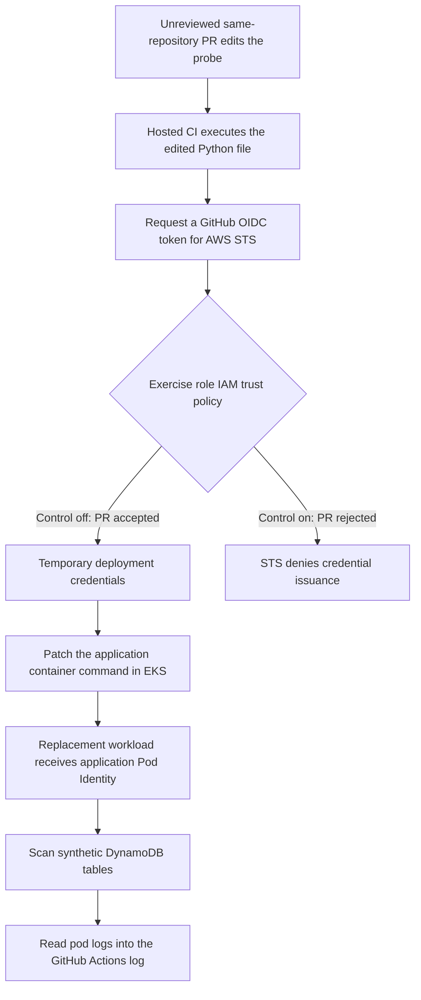

# CI Identity Heist Purple Team Tabletop Excercise

A security sandbox demonstrating how code in an unreviewed pull request can cross a CI identity boundary, obtain AWS deployment credentials, and read application data. An IAM trust control blocks the same attack before credentials are issued.

Mybank is a fictional banking API running on AWS EKS with DynamoDB and GitHub Actions. All customer records, accounts, and transfers are synthetic. The repository includes the application, infrastructure, attack and control implementations, setup instructions, and recorded CI evidence.

**Current state:** the AWS environment is torn down. Live release, attack-demo, and control-deployment workflows are disabled; the recorded runs below remain the demonstration. Local application and infrastructure validation checks remain available.

## Watch the demonstration

Open either run below, select **verify-boundary**, and expand **Execute PR-editable probe (grabs the identity; on a PR, demonstrates impact)**.

| Control | Recorded run | What to look for |
| --- | --- | --- |
| Off | [Attack obtains deployment credentials and reads synthetic records](https://github.com/aleduenas/ci-identity-heist-demo/actions/runs/39293282632/job/118199178766) | An assumed-role identity, followed by `STOLEN CUSTOMER RECORDS` in the CI log. |
| On | [Same attack blocked by IAM](https://github.com/aleduenas/ci-identity-heist-demo/actions/runs/39293816912/job/118201042196) | `AssumeRoleWithWebIdentity` is denied before the payload can replace the application. The failed check is the expected prevention result. |

The logs are execution evidence. The [walkthrough](docs/demo.md) explains the sequence and expected results without requiring access to the logs. GitHub may require sign-in to expand logs, and log availability depends on Actions retention.

## The vulnerability: unreviewed CI code can obtain a deployment identity

The intentionally vulnerable configuration lets a pull-request validation job assume an AWS role that can change the running application. This crosses the trust boundary between **code awaiting review** and **code authorized to deploy**. Opening the PR is enough to execute the edited probe; the attacker never needs to merge the payload into `main`.

The root cause is the exercise role's **IAM trust policy**. GitHub Actions can issue an OpenID Connect (OIDC) token identifying a job's repository and execution context. AWS Security Token Service (STS) checks that token against the role's trust policy before issuing temporary AWS credentials. With enforcement off, this lab deliberately accepts the repository's `pull_request` context alongside its trusted `main` contexts. A genuine token from an unreviewed PR therefore satisfies the policy.

The token is valid and AWS is enforcing the configured policy. The security mistake is treating PR execution as an authorized deployment context. A read-only GitHub `contents` token does not prevent this: the probe job separately has `id-token: write`, which lets its code request an OIDC token. Whether that token can become AWS credentials is decided by IAM trust. No long-lived AWS key needs to be stored in GitHub or leaked from a secret.

The resulting impact comes from the permissions attached to two different identities:

| Identity | Relevant authority | Why it matters |
| --- | --- | --- |
| Exercise deployment role | AWS `eks:DescribeCluster`, plus an EKS access entry mapped to namespace RBAC for patching `mybank-api` and reading pod logs | The attacker can change what the application executes and retrieve its output. This role has no direct DynamoDB read permission. |
| Application Pod Identity role | Reads the synthetic customer, account, and transfer tables, including `dynamodb:Scan` | Code running as the application can enumerate those tables. Replacement workload code receives the same application identity. |

This makes deployment permission an indirect path to data access. Limiting the deployment role's direct AWS permissions does not isolate it from the data privileges of code it can replace. The EKS API is reachable from the hosted CI runner in this lab and still requires IAM authentication and Kubernetes authorization; the application itself remains a private ClusterIP service.

## The sampled red-team action

The sample models an attacker who can edit a same-repository branch that CI will execute. In a broader scenario, that starting access could come from a compromised developer or coding-agent account. This exercise simulates that access with an owner-authored PR; it does not implement the initial account compromise. The demonstration workflows require the owner as the triggering actor and exclude fork PRs, so an arbitrary visitor cannot start this exercise by submitting a public PR.

The objective is to turn an ordinary source-file change into application data exposure. The payload lives in [`scripts/detection/demo_probe.py`](scripts/detection/demo_probe.py), a file the workflow already executes. It is committed as a commented example next to a harmless status check. The simulated attacker comments out the normal `smoke_check()` entry point, uncomments `run_attack()` and its entry point, and submits that change without modifying the workflow YAML.



The payload executes these stages:

1. **Run before review.** Creating or updating the same-repository PR starts the identity-boundary workflow when it is enabled. Its hosted runner checks out the PR revision and runs the probe. The Python process therefore executes the attacker's version of the file while the PR remains unmerged.
2. **Exchange CI identity for AWS credentials.** The script requests a GitHub OIDC token with the audience `sts.amazonaws.com`, then calls `AssumeRoleWithWebIdentity` for `DETECTION_DEMO_ROLE_ARN`. Under permissive trust, STS returns a 15-minute credential session. The probe calls `GetCallerIdentity` and prints `obtained_identity` as evidence. Its `release-looking-demo` session name is only a label; it does not change the signed PR context or make the run a trusted release.
3. **Use the deployment identity against EKS.** The script obtains cluster connection details and authenticates as the exercise role. The role's EKS access entry and Kubernetes RBAC allow it to patch the `mybank-api` Deployment and read pod logs. The demonstration does not require cluster-administrator access, Kubernetes Secret access, or permission to execute commands inside an existing pod.
4. **Replace application behavior.** The patch overrides the existing container's startup command with a small Python data reader and removes its health probes. It keeps the existing image and service account. New pods run the reader with the application's Pod Identity credentials, so the attack does not need to build a malicious image or change IAM permissions to reach the tables.
5. **Expose synthetic records through logs.** The reader uses the AWS SDK to scan the configured customer, account, and transfer tables, following paginated results, and writes them to pod stdout after `STOLEN CUSTOMER RECORDS`. The CI process reads those pod logs and copies them into its own Actions output. This is the demo's exfiltration channel: synthetic application data leaves the workload through logs the attacker can inspect. There is no external collection server, and the probe does not print the raw OIDC token or temporary secret keys.
6. **Attempt to restore the application.** After collecting output, the payload invokes `kubectl rollout undo`. This demonstrates a cleanup attempt, not guaranteed recovery: an interrupted run or failed undo can leave the workload changed. An operator must check rollout status and readiness before treating the application as restored.

The chain crosses two boundaries: **PR code gains a deployment identity**, then **deployment authority becomes application data access**. The first is the deliberately misconfigured trust decision; the second follows from the deployment role's ability to replace code that already has data privileges.

## How the control stops the attack

[`security/control.json`](security/control.json) contains one boolean, `enforcement_enabled`. [`apply_control.py`](scripts/detection/apply_control.py) turns that setting into the exercise role's IAM trust policy:

| Signed job context | Control off (`false`) | Control on (`true`) |
| --- | --- | --- |
| This repository, `main` push | Allowed | Allowed |
| This repository, manual run on `main` | Allowed | Allowed |
| This repository, pull-request run | Allowed for the exercise | Denied |

Both states require the intended GitHub OIDC provider, the STS audience, and the exact immutable repository identity. Enabling enforcement removes the PR subject pattern while retaining the intended `main` event contexts. Run and attempt counters can vary; the repository and allowed execution contexts stay constrained.

When the environment is running and the workflow is enabled, an authorized change to the setting on `main` starts **Deploy security control**. It assumes a separate security automation role that can only read and update the exercise role's trust policy. The script validates the boolean, target role, and recognized policy shape, applies the desired trust, and verifies IAM readback. A second job checks that `main` can still obtain the **same exercise role**. An edit to the setting on an unmerged PR does not deploy the policy.

On a fresh attack attempt after IAM propagation, the PR can still execute Python and request a GitHub OIDC token, but STS refuses to exchange that PR identity for deployment credentials. The payload stops before the EKS patch and data read. This is why the recorded control-on run has a failed probe check: denial is the intended result. A harmless probe continues to pass because it makes no AWS credential request.

The control prevents new PR credential issuance. It does not classify malicious code, revoke sessions already issued, or undo data exposure. Writers of trusted `main` remain inside the security boundary; malicious code merged there requires additional protections. The optional [CloudTrail/GitHub collector](docs/detection/README.md) provides separate evidence about credential use; it is not the enforcement mechanism.

The committed setting is **on**, but the AWS environment is currently torn down. The file represents the desired state for a provisioned sandbox, rather than proof of a live deployment. See the [control explanation](security/README.md) for policy and verification details.

## Follow the source

| File | Role in the demo |
| --- | --- |
| [`scripts/detection/demo_probe.py`](scripts/detection/demo_probe.py) | Harmless default probe and commented red-team payload |
| [`security/control.json`](security/control.json) | Versioned enforcement switch |
| [`scripts/detection/apply_control.py`](scripts/detection/apply_control.py) | Builds, applies, and verifies the IAM trust control |
| [Identity boundary workflow](.github/workflows/detection-demo.yml) | PR execution path and OIDC token permission |
| [Exercise role trust](infra/modules/detection/trust.tf) and [permissions](infra/modules/detection/permissions.tf) | Initial role trust, AWS permissions, and EKS identity mapping |
| [Deployer RBAC](deploy/kubernetes/base/rbac/deployers.yaml) | Application patch and pod-log permissions |
| [Application identity](infra/modules/identity/app.tf) | Pod Identity association and synthetic table permissions |
| [Security control workflow](.github/workflows/security-control.yml) | Trusted control deployment and legitimate main-access verification |

## Run locally

The application and tests run without AWS or GitHub credentials. Requires Python 3.12+ and Docker with Linux containers.

```bash
python -m venv .venv
source .venv/bin/activate
python -m pip install -e '.[dev]'
export APP_API_KEY=$(python -c 'import secrets; print(secrets.token_urlsafe(32))')
docker compose up --build --wait
python scripts/checks/local_api.py
python -m pytest tests
docker compose down
```

On PowerShell, activate with `.venv/Scripts/Activate.ps1` and set the key with `$env:APP_API_KEY = python -c "import secrets; print(secrets.token_urlsafe(32))"`. The API is at `http://localhost:8000/docs`; business routes require `X-API-Key`. Local data resets when DynamoDB Local restarts. This local slice exercises the application; the CI-to-AWS attack requires the separate sandbox setup.

## Explore or reproduce

| Guide | Contents |
| --- | --- |
| [Demo walkthrough](docs/demo.md) | Full attack/control comparison, setup prerequisites, evidence, and reset |
| [Architecture](docs/architecture.md) | AWS components, identities, and trust boundaries |
| [Infrastructure](docs/infrastructure.md) and [delivery](docs/delivery.md) | Provisioning, repository variables, and application bootstrap |
| [Testing](docs/testing.md) | Local checks and live acceptance cases |
| [Detection](docs/detection/README.md) | Optional independent CloudTrail/GitHub evidence collection |
| [Teardown](docs/teardown.md) | Removing billable sandbox resources |

This repository is published for inspection. Contributions and live exercise runs are reserved for the owner; reproduce the AWS exercise in your own isolated sandbox using a private copy.
