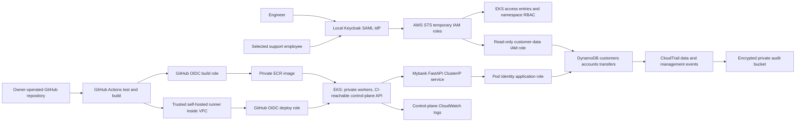
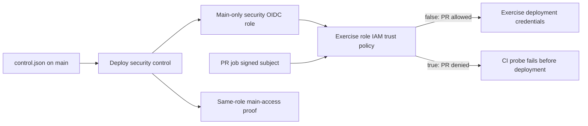

# Mybank EKS sandbox architecture

Repository: `aleduenas/ci-identity-heist-demo` (public security demonstration). Live exercise reproduction uses an owner-operated private copy; see the [demo walkthrough](demo.md).

## Purpose and boundary

The lab models a small, production-shaped AWS environment for authorized security exercises. Mybank is a fictional bank; all customer identities, accounts, and transfers are synthetic. Region defaults to `us-east-1`.

## System layout

## AWS infrastructure

One isolated VPC spans two availability zones. Private subnets host a small managed EKS node group with no public IPs. Public subnets contain a single NAT gateway for outbound image and package access; this is a documented lab cost and availability compromise. A DynamoDB gateway endpoint keeps database traffic within AWS networking. The Kubernetes API endpoint defaults to private. The lab explicitly enables `cluster_public_access=true` so the GitHub-hosted PR runner can reach the IAM/RBAC-authenticated API and demonstrate the deploy-to-data pivot. Worker nodes and the application Service remain private. ClusterIP application access is through `kubectl port-forward` from a VPC-connected machine; no public ingress is provisioned initially.

EKS uses API access entries, explicitly assigned bootstrap administrators, and custom namespace RBAC for deployment and engineering. Managed add-ons include VPC CNI, kube-proxy, CoreDNS and the EKS Pod Identity agent. Workloads get their own IAM role through Pod Identity; node roles have no application-data privileges. ECR stores immutable image tags. DynamoDB uses on-demand capacity, encryption and point-in-time recovery. CloudTrail records management operations and data events on the lab's tables; EKS control-plane audit logging is enabled.

Infrastructure components separate networking, EKS, data, audit, identity, delivery IAM and an optional private operations host. Isolated exercise roles model the attack boundary without widening the baseline release roles. Kubernetes configuration is a separate administrative concern from routine application releases.

## Application and data contract

The application is a JSON FastAPI service rather than a banking frontend. Its packages separate settings, HTTP schemas/routes, business services, and persistence. Docker Compose provides a local DynamoDB instance and the same API for development. Local fixture tooling creates tables and seeds clearly fictional identities.

| Table | Partition key | Contents |
| --- | --- | --- |
| customers | customer_id | Synthetic name and contact details |
| accounts | account_id | Customer owner, currency CAD, integer balance_cents |
| transfers | transfer_id | Source, destination, amount_cents, creation time, actor |

Environment variables: `AWS_REGION`, `DYNAMODB_ENDPOINT_URL` (local only), `CUSTOMERS_TABLE`, `ACCOUNTS_TABLE`, `TRANSFERS_TABLE`, `APP_API_KEY`. The app listens on port 8000. Routes: `GET /health`, `GET /ready`, `GET /accounts/{account_id}`, `POST /transfers`, and `GET /transfers/{transfer_id}`. Business routes require the configured lab API key; health probes do not. This key is supplied outside Git, via a Kubernetes Secret during bootstrap. Employee SAML is AWS access federation, not customer application login.

Transfers atomically debit, credit, and insert the immutable ledger record using DynamoDB transactions. Conditions reject overdrafts, missing accounts, same-account transfers, and non-positive amounts. The transfer ID is an idempotency key: matching retries return the existing transfer, and reuse with different parameters returns a conflict. Monetary amounts use integer cents. Tests exercise atomicity, rejection paths, and retries.

## Human identity and elevated access

Local Keycloak, bound to loopback, imports a Mybank realm with engineer and support groups. SAML assertions map group membership to AWS IAM role/provider ARN pairs. The IAM SAML provider uses metadata exported from the running realm, and the engineer/support roles trust that provider. The signing certificate and role claims must match the configured identities; no fabricated signing certificate is included.

Engineer access permits describing the cluster and reading namespace workloads/logs through RBAC. It does not include direct customer-table reads. A small support group can read synthetic customer/account/transfer records through AWS APIs and has no table writes or cluster administration. Bootstrap administrators are supplied separately by ARN. IAM and Kubernetes permissions are additive: application deployers can replace workload code and therefore can indirectly exercise its data privileges; the deployment role is a trusted release boundary. The lab documents this explicitly rather than promising isolation Kubernetes cannot provide.

The local HTTP Keycloak development service is an intentional lab simplification. AWS consumes signed SAML assertions via the browser or STS; it does not need inbound access to localhost. The metadata signing certificate must match the running realm. The documentation will distinguish browser console federation from acquiring temporary CLI credentials for `kubectl`.

## Delivery workflow

Owner-authored, same-repository pull requests run application and Kubernetes checks on GitHub-hosted workers. Workflow entry jobs require the repository owner as the triggering actor.
Internal environment checks have a separate workflow triggered by infrastructure
changes or explicit dispatch. Trusted main application releases test/build a
commit-tagged image, assume a build role through OIDC and push to ECR. A separate
deploy job uses the VPC-connected trusted runner and its own OIDC deploy role to
update the application image and wait for rollout. Untrusted PRs never use that
runner. Security-only main commits skip the application release.

## Live exercise and security-control delivery

The exercise role is distinct from the normal release roles. When the committed
setting is false, an unreviewed same-repository PR can obtain that role. Its EKS
access entry maps to namespace RBAC that permits patching mybank-api and reading
pod logs. The payload changes the container command while retaining the image and
service account. Replacement pods receive the application's Pod Identity role,
whose current policy includes Scan on the synthetic tables. The deployment role
itself has no direct table-read permission. Synthetic output travels into owned
GitHub Actions logs; no webhook receiver is part of this implementation.

The security role can only read/update that exercise role's trust. The visible,
commented script validates inputs and known policy shapes, prints before/desired
policies, updates IAM only if needed and verifies readback. Its second workflow
job proves main can still obtain the same role. Ordinary harmless PR checks make
no AWS request, so their success is a separate positive case. See the
[security control](../security/README.md) for how it is deployed and verified.

The control code is already written, enabled through the committed
setting and prepared workflow. Production delivery would use a reviewed security
workflow or another security-as-code process. Main-context
IAM trust is not isolation to one workflow file; main writers remain trusted and
review protections must be verified rather than assumed. The optional CloudTrail
collector observes events independently but does not enforce or revoke anything.

A private EC2 operations host with SSM access provides the runner machine and an operator tunnel to EKS. Runner registration tokens remain outside version control. The host role has only SSM permissions. Administrative bootstrap configures the namespace, service account, RBAC, Service, policies and Deployment. Subsequent delivery updates the image. No AWS access keys are stored in GitHub. OIDC trusts are bound to this repository and `main`; repository and workflow write access are part of the trusted release boundary.

## Operational phases and acceptance

1. Use an owner-operated private repository and dedicated synthetic AWS sandbox to reproduce the live exercise. This repository provides the source and recorded runs.
2. Enable the [security control](../security/README.md) for the exercise; employee federation is optional supporting infrastructure.
3. Run local checks and a container smoke test when tooling permits; record actual results.
4. An authorized operator prepares the AWS environment in the owned lab account.
5. Operator bootstraps Kubernetes from inside the VPC, registers the trusted runner, configures repository variables, and exercises CI deployment.
6. Operator starts Keycloak, imports generated role claims, exports metadata, enables federation, and verifies positive and negative engineer/support access cases.
7. Seed synthetic data; test a transfer, idempotent retry, rejected overdraft, and audit visibility.
8. Teardown application resources and AWS roots; separately empty/version-clean state and audit buckets as documented.

Acceptance requires observed identity setup, daily delivery, transactional invariants, least-privilege checks and recovery. Static configuration checks do not prove that AWS resources exist; application tests do not prove live EKS or SAML.

## Component boundaries

`infra/` provisions AWS, `app/` owns the transactional API, `deploy/` owns Kubernetes manifests,
and `identity/` owns optional employee federation. `scripts/demo/` coordinates the exercise lifecycle;
`scripts/detection/` contains the probe, independent collector, detector and prevention control.
`security/control.json` is the versioned enforcement setting. A main-only GitHub
workflow applies it directly through IAM using a separate automation role limited
to reading/updating the exercise role's trust. The control code and identities
are provisioned ahead of time; the committed setting enables the prepared example.
Main repository writers are trusted to deploy security changes; the automation
role never accepts PR subjects, including when exercise enforcement is disabled.
See the [security control](../security/README.md) for deployment and verification.
Local credentials and generated operator artifacts are excluded from Git.

## Source references

- [EKS access entries](https://docs.aws.amazon.com/eks/latest/userguide/access-entries.html)
- [IAM SAML provider setup](https://docs.aws.amazon.com/IAM/latest/UserGuide/id_roles_providers_create_saml.html)
- [GitHub OIDC for AWS](https://docs.github.com/en/actions/how-tos/secure-your-work/security-harden-deployments/oidc-in-aws)
- [Keycloak container realm import](https://www.keycloak.org/server/containers)
- [EKS Kubernetes lifecycle](https://docs.aws.amazon.com/eks/latest/userguide/kubernetes-versions.html)
