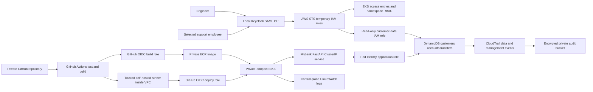

# Mybank EKS sandbox architecture

Status: implementation contract, 2026-10-13. Repository: `aleduenas/mybank-eks-sandbox` (private).

## Purpose and boundary

Build a small, production-shaped AWS environment for authorized security exercises. Mybank is a fictional bank; all customer identities, accounts, and transfers are synthetic. This repository creates the environment and its normal operational workflows. Region defaults to `ca-central-1`. Infrastructure is prepared as code; AWS apply is an explicit operator action.

## System layout

## AWS infrastructure

One isolated VPC spans two availability zones. Private subnets host a small managed EKS node group with no public IPs. Public subnets contain a single NAT gateway for outbound image and package access; this is a documented lab cost and availability compromise. A DynamoDB gateway endpoint keeps database traffic within AWS networking. The Kubernetes API endpoint is private. ClusterIP application access is through `kubectl port-forward` from a VPC-connected machine; no public ingress is provisioned initially.

EKS uses API access entries, explicitly assigned bootstrap administrators, and custom namespace RBAC for deployment and engineering. Managed add-ons include VPC CNI, kube-proxy, CoreDNS and the EKS Pod Identity agent. Workloads get their own IAM role through Pod Identity; node roles have no application-data privileges. ECR stores immutable image tags. DynamoDB uses on-demand capacity, encryption and point-in-time recovery. CloudTrail records management operations and data events on the lab's tables; EKS control-plane audit logging is enabled.

Infrastructure modules separate networking, EKS, data, audit, identity, delivery IAM and an optional private operations host. The composition root only connects modules and exports operator-facing outputs. A bootstrap root prepares an encrypted, versioned S3 Terraform-state bucket with state locking. Kubernetes is installed in a separate phase after AWS provisioning, avoiding provider dependencies on a cluster that does not exist yet.

## Application and data contract

The application is a JSON FastAPI service rather than a banking frontend. Its packages separate settings, HTTP schemas/routes, business services, and persistence. Docker Compose provides a local DynamoDB instance and the same API for development. Local fixture tooling creates tables and seeds clearly fictional identities.

| Table | Partition key | Contents |
| --- | --- | --- |
| customers | customer_id | Synthetic name and contact details |
| accounts | account_id | Customer owner, currency CAD, integer balance_cents |
| transfers | transfer_id | Source, destination, amount_cents, creation time, actor |

Environment variables: `AWS_REGION`, `DYNAMODB_ENDPOINT_URL` (local only), `CUSTOMERS_TABLE`, `ACCOUNTS_TABLE`, `TRANSFERS_TABLE`, `APP_API_KEY`. The app listens on port 8000. Routes: `GET /health`, `GET /ready`, `GET /accounts/{account_id}`, `POST /transfers`, and `GET /transfers/{transfer_id}`. Business routes require the configured lab API key; health probes do not. This key is supplied outside Git, via a Kubernetes Secret during bootstrap. Employee SAML is AWS access federation, not customer application login.

Transfers atomically debit, credit, and insert the immutable ledger record using DynamoDB transactions. Conditions reject overdrafts, missing accounts, same-account transfers, and non-positive amounts. The transfer ID is an idempotency key: matching retries return the existing transfer, and reuse with different parameters returns a conflict. Monetary amounts use integer cents. Tests exercise atomicity, rejection paths, and retries.

## Human identity and elevated access

Local Keycloak, bound to loopback, imports a Mybank realm with engineer and support groups. SAML assertions map group membership to AWS IAM role/provider ARN pairs. The operator exports real metadata, then Terraform creates the IAM SAML provider and engineer/support roles. No fabricated signing certificate is included. Configuration occurs in two phases: deploy foundational AWS resources, generate/import the realm with resulting ARNs, obtain metadata, then enable federation in Terraform.

Engineer access permits describing the cluster and reading namespace workloads/logs through RBAC. It does not include direct customer-table reads. A small support group can read synthetic customer/account/transfer records through AWS APIs and has no table writes or cluster administration. Bootstrap administrators are supplied separately by ARN. IAM and Kubernetes permissions are additive: application deployers can replace workload code and therefore can indirectly exercise its data privileges; the deployment role is a trusted release boundary. The lab documents this explicitly rather than promising isolation Kubernetes cannot provide.

The local HTTP Keycloak development service is an intentional lab simplification. AWS consumes signed SAML assertions via the browser or STS; it does not need inbound access to localhost. The metadata signing certificate must match the running realm. The documentation will distinguish browser console federation from acquiring temporary CLI credentials for `kubectl`.

## Delivery workflow

Pull requests run application checks, Terraform formatting/validation and Kubernetes manifest checks. Trusted pushes to `main` test and build an image tagged with the commit SHA, assume a build role through GitHub OIDC, and push to ECR. A separate deploy job uses a pre-provisioned trusted runner with VPC access, assumes its own OIDC role, updates only the application Deployment image, and waits for rollout. Untrusted pull requests never run on the private runner. The workflow runs on each merge and supports manual dispatch.

A private EC2 operations host with SSM access provides the runner machine and an operator tunnel to EKS. GitHub runner registration is an operator step; Terraform contains no registration token. The host role has only SSM permissions. The first release requires an admin to apply namespace, service account, RBAC, service, policies and Deployment. Subsequent delivery updates the image. No AWS access keys are stored in GitHub. OIDC trusts are bound to this repository and `main`; repository and workflow write access are part of the trusted release boundary.

## Operational phases and acceptance

1. Create and verify the private repository; commit this architecture before parallel implementation.
2. Implement modules, app, identity fixtures and pipeline in disjoint directories.
3. Run local checks and a container smoke test when tooling permits; record actual results.
4. Operator creates state storage, reviews Terraform plan and applies AWS resources with an authenticated lab account.
5. Operator bootstraps Kubernetes from inside the VPC, registers the trusted runner, configures repository variables, and exercises CI deployment.
6. Operator starts Keycloak, imports generated role claims, exports metadata, enables federation, and verifies positive and negative engineer/support access cases.
7. Seed synthetic data; test a transfer, idempotent retry, rejected overdraft, and audit visibility.
8. Teardown application resources and AWS roots; separately empty/version-clean state and audit buckets as documented.

Acceptance requires documented provisioning, identity setup, daily delivery, transactional invariants, least-privilege checks and teardown. Terraform validation does not prove an AWS apply; application tests do not prove live EKS or SAML. Those distinctions remain visible in the implementation status.

## Ownership and resumability

| Component | Paths | Responsibility |
| --- | --- | --- |
| Infrastructure | infra/ | Bootstrap state, six modules, environment root |
| Application | app/, tests/app/, Dockerfile | API, repository, business invariants, fixtures |
| Delivery | deploy/, .github/, scripts/deploy/, docs/delivery.md | Kubernetes, CI/CD, runner/bootstrap procedures |
| Identity and integration | identity/, scripts/identity/, docs/, README.md | Keycloak SAML generation, operator guide, review |

`docs/implementation-status.md` is the handoff ledger. Each component has a README and focused files. Large monolithic files are avoided; shared contracts are changed only with integration review. This design is independent of the older service-demand MLOps project brief supplied in the workspace instructions.

## Source references

- [EKS access entries](https://docs.aws.amazon.com/eks/latest/userguide/access-entries.html)
- [IAM SAML provider setup](https://docs.aws.amazon.com/IAM/latest/UserGuide/id_roles_providers_create_saml.html)
- [GitHub OIDC for AWS](https://docs.github.com/en/actions/how-tos/secure-your-work/security-harden-deployments/oidc-in-aws)
- [Keycloak container realm import](https://www.keycloak.org/server/containers)
- [EKS Kubernetes lifecycle](https://docs.aws.amazon.com/eks/latest/userguide/kubernetes-versions.html)
